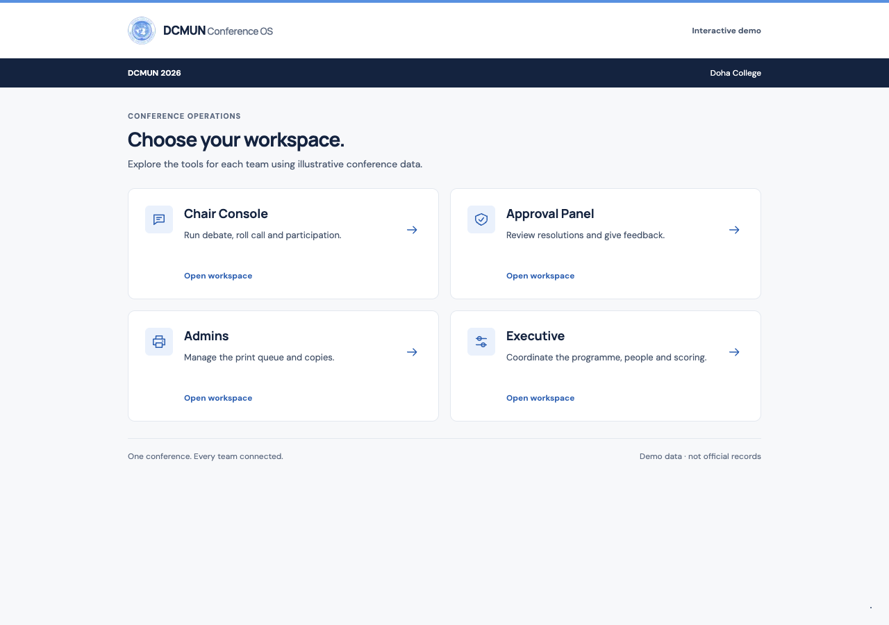
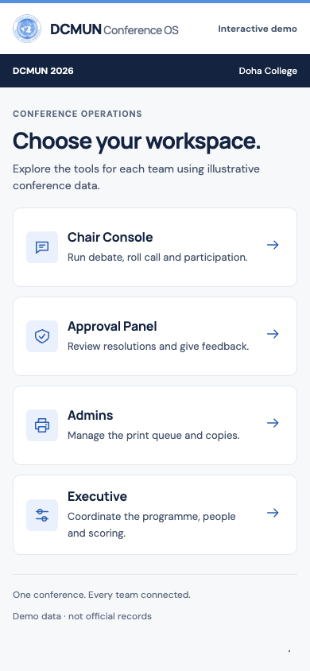

# Assembly home — workspace chooser proposal

Owner-requested design, 20 October 2026. **Implemented as a local reference for Claude's review**, on
`codex/priority-chair-ui`; not a claim of production release. Continue the all-workspace button/spacing cleanup
from [CLAUDE_VISUAL_CLEANUP.md](CLAUDE_VISUAL_CLEANUP.md), using this screen as a concrete starting point.

## Design intent

The entry screen should get staff into their work. Replace the oversized slogan, gradients, coloured role
icons and long marketing footer with a compact operational page. Adapt the selected Assembly shell: one
unaltered DCMUN seal/wordmark, a navy conference-context band, off-white paper, white working surfaces and
UN-blue action/focus details. Apply DeutschLab's semantic colour roles, 4 px spacing scale and clear hierarchy,
as recorded in [BRAND.md](BRAND.md).

## Proposed screen

Desktop reference — all four workspace destinations are in the first viewport:

Phone reference — the same cards become compact rows; each entire row is the link:

Screenshots use isolated local **demo** data, with an illustrative conference name/venue. They demonstrate
layout and navigation, not authenticated staging or actual conference status. Live staff see their granted
workspaces only; four cards are not forced on a person with fewer roles.

## Composition and content

1. **Identity header:** one seal lockup on white, with plain Staff workspace / Interactive demo text. Do not
   duplicate the seal in the body, imply an online/synced state, or use an arbitrary staff identity.
2. **Conference band:** the name and venue already in the authorised snapshot. No hard-coded live date,
   inferred session status, decorative status dot or made-up operational counters.
3. **Heading:** `Choose your workspace.` One short explanatory line, appropriate to demo or staff access.
4. **Four possible destinations:** Chair Console — debate, roll call, participation; Approval Panel — review
   and feedback; Admins — print queue/copies; Executive — programme, people, scoring. Each card contains a
   consistent 40 px icon, title, task description and aligned arrow. Open workspace appears on desktop as
   secondary text within the same link, not a nested button or extra focus stop.
5. **Quiet footer:** one shared-workflow line, then the demo-data notice or how to request another role.
   Access copy does not claim that current changes were saved or synced.

## Layout, spacing and interaction

- Maximum frame 960 px; 24 px horizontal gutters, 16 px on phones. Intro uses 28 px heading and existing
  body/type tokens. Metadata remains at least 12 px apart from the existing 11 px uppercase kicker.
- Two equal columns above 600 px; one column below. Cards use 24 px desktop padding, 16 px on phones;
  gaps are 16 / 12 px. Desktop minimum height 160 px; phone minimum 100 px. Titles use 18 / 16 px.
  Long names/descriptions wrap without clipping or pushing the arrow outside its column.
- Hairline container borders and the existing container radius. All roles share the same neutral/blue
  language; colour is not used to invent separate brands for different roles. No floating shadows or gradient.
- One whole-card link per workspace. Pointer hover changes border/background; keyboard focus adds the visible
  3 px ring. A Skip to workspaces link is first in keyboard order. No hover-only action or nested controls.
- Only 120 ms colour transitions; reduced motion disables them. No entry delay, stagger, looping animation,
  new animation library, idle timer or background request is introduced. Existing Orbit loading stays in the
  access/initialisation and redirect paths.

## Access and data states preserved

| State | Result |
| --- | --- |
| Active grant for one workspace | Existing direct entry and Orbit placeholder; no chooser flash. |
| Active grants for multiple workspaces | Only those destinations, in the stable existing role order. |
| Demo | Four exploratory roles, clearly labelled demo. |
| Loading | Existing access/loading screen; no speculative role cards. |
| Signed out / no access | Existing staff-code/recovery gate; no workspace cards. |

The home is a presentation of the existing conference snapshot and role grants. No RPC, table, network poll,
authentication, permission, outbox or scoring behavior changes. The actual work routes and the stable sync
strip within them are preserved. This design is the staff workspace chooser, not a new conference-selection
system or public marketing site.

## Implementation reference and verification

- `components/workspace-home.tsx` and its CSS module hold the design; `lib/workspaces.ts` shares stable role
  names with the operational masthead. `Workspace` retains the direct-entry/access behavior.
- Removed 50 obsolete chooser CSS rules (235 lines) from the global stylesheet. The new styles are scoped,
  rather than another set of global overrides. Other workspace primitives remain Claude's cleanup task.
- Automated suite: **420 tests, 416 passed, 4 existing PostgreSQL 17 concurrency skips, 0 failures**. New route
  renders cover demo, granted-only roles, sole-role/loading and signed-out/no-access states. Typecheck, lint
  without warnings and production build pass.
- Production-build Chrome demo checks at **1280×900, 768×1024, 390×844 and 320×640**: the intended grid/rows,
  all four desktop cards in the first viewport, no horizontal overflow, real link navigation to all four
  workspaces, retained status strip, skip link and visible keyboard focus. The 320 px run uses reduced motion.
- Raw checks/screenshots are in ignored `artifacts/home-proposal/`; the desktop/phone images above are tracked
  so Claude receives them with the handoff. Local preview: `http://localhost:3123/`.

Not verified: authenticated staging, real screen-reader announcements, actual 200% browser zoom, long translated
copy or representative school hardware. The local role-gate renders do not replace live access verification.

Claude: review the proposal and reference implementation, then carry its spacing, action hierarchy and
responsive discipline into the remaining screens. Preserve the owner-approved feature checklist in
[UI_PRIORITY_PASS.md](UI_PRIORITY_PASS.md); global button/spacing work remains pending.
